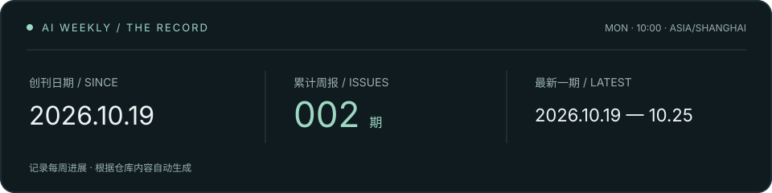

<div align="center">


# AI Weekly

**AI 行业周报 · 每周整理全球 AI 进展**

全球厂商 · 模型与算法 · 重要观点

[开始阅读](#开始阅读) · [每周更新](#每周更新) · [内容维护](#内容维护) · [MIT License](LICENSE)

</div>

<!-- weekly-stats:start -->


<sub>创刊日期按首次发布日期计算；统计随每次构建自动更新。</sub>
<!-- weekly-stats:end -->

---

AI Weekly 每周整理美国、中国与欧洲主要 AI 厂商的动态、模型与算法进展，以及研究者和行业领导者的重要观点。周报附来源链接，按日期归档，方便阅读和查阅。

网站在本机运行，已下载的周报可离线阅读。

## 阅读体验

| 功能 | 说明 |
| --- | --- |
| 每周归档 | 首页展示最新一期，历史周报按日期排列，每期都有独立页面 |
| 搜索与筛选 | 按厂商、模型或正文关键词搜索，也可按主题筛选 |
| 长文阅读 | 文章目录、阅读进度、明暗切换，适配桌面与窄屏 |
| 来源与导出 | 保留原始链接，支持下载 Markdown、打印或保存 PDF |
| 离线使用 | 页面不依赖 CDN、网络字体或前端框架；打开外部来源时才需联网 |

## 开始阅读

首次使用，先下载仓库：

```sh
git clone https://github.com/EricZhangpku/AI-Weekly.git
cd AI-Weekly
```

### macOS：双击打开

在项目目录中双击 **`打开周报.command`**，脚本会启动本地服务，并用 Microsoft Edge 打开网站。

### 命令行启动

需要 **Python 3.9 或更高版本**，无需安装第三方依赖。在项目根目录运行：

```sh
python3 scripts/manage.py start
```

然后访问 **[http://127.0.0.1:8765/](http://127.0.0.1:8765/)**。

| 操作 | 命令 |
| --- | --- |
| 启动服务 | `python3 scripts/manage.py start` |
| 查看状态 | `python3 scripts/manage.py status` |
| 停止服务 | `python3 scripts/manage.py stop` |

服务仅在本机运行，电脑重启后需要再次启动。也可以直接用浏览器打开 [`site/index.html`](site/index.html)，无需启动服务。

## 获取最新周报

每周一更新完成后，在项目根目录拉取一次仓库，再刷新网页即可阅读新一期：

```sh
git pull --ff-only
```

仓库包含生成好的网页，无需重新构建。若你修改了本地文件，请先提交或备份修改，再拉取更新。

## 每周更新

**每周一 10:00（Asia/Shanghai）开始整理，覆盖前一周一至周日。**

1. **收集信息**：检索厂商公告、论文、模型卡、独立测评与当事人原帖。
2. **整理内容**：核对事件日期，区分厂商自述、测评结果与编辑判断。
3. **撰写与润色**：按 language-demand 撰写正文、摘要和页面文案，再用 humanizer-zh 润色，保留事实、来源与必要限定。
4. **更新网站**：新增一期，重新生成首页、归档，以及网站和 README 的期数统计。
5. **同步 GitHub**：提交本期内容和生成文件，推送仓库后提醒阅读。

更新由本机的 Codex 定时任务执行，需要电脑保持唤醒、应用运行且网络可用。其他电脑拉取仓库后即可阅读；如需自行运行定时任务，可按 [`WORKFLOW.md`](WORKFLOW.md) 配置更新流程，也可以手动维护内容。

## 内容维护

每一期由两个文件组成，以该周的**周日日期**命名：

```text
content/issues/
├── 2026-10-18.md     # 完整文章与来源链接
└── 2026-10-18.json   # 标题、日期、摘要、主题与地区速览
```

参照现有期刊添加内容后，在项目根目录执行：

```sh
python3 scripts/build.py
python3 scripts/check.py
```

构建脚本根据有效的周报文件自动统计总期数和创刊日期，更新 README 计时板块、网站首页、归档、独立文章页及 Markdown 下载文件；检查脚本会核对本地链接、锚点和重复 ID。修改文章时编辑 `content/issues/` 中的源文件，再重新构建。

完整的资料收集与编辑要求见 [`WORKFLOW.md`](WORKFLOW.md)。

## 项目结构

```text
AI-Weekly/
├── content/
│   ├── issues/           # 周报正文与元数据
│   └── evidence/         # 来源证据与修订记录
├── site/
│   ├── index.html        # 首页与归档
│   ├── issues/           # 各期独立页面
│   ├── downloads/        # Markdown 下载文件
│   └── assets/           # 样式、脚本与图标
├── scripts/
│   ├── build.py          # 生成网站
│   ├── check.py          # 检查内部引用
│   ├── manage.py         # 管理本地服务
│   └── serve.py          # 静态文件服务
├── 打开周报.command       # macOS 快捷入口
├── WORKFLOW.md           # 每周编辑流程
└── LICENSE
```

## 许可证

本项目采用 [MIT License](LICENSE)。
